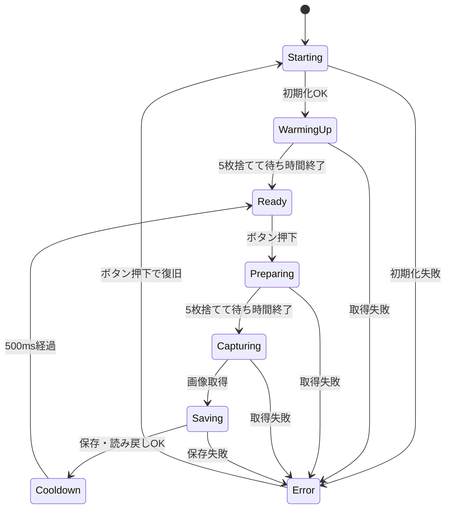

# 内部の作り

ハードは camera-main と同じ。

## 状態

状態は `camera_control.cpp` の `CaptureState` だけで持つ。外から書き換えるところはない。

Ready LEDは `Ready` のときだけ、エラーLEDは `Error` のときだけ点く。エラーの原因は `CaptureError` に入れて、シリアルに出す。

`main.cpp` は `setup()` で `beginCapture()`、`loop()` で `updateCapture()` を呼ぶだけ。状態は `captureState()` / `captureError()` で取れる。

## 待ち時間とボタン

起動時は300ms間隔、撮影前は50ms間隔で5枚ずつ捨てる（元と同じ間隔）。`delay()` は使わず毎ループ経過時間を見る。

ただしSD・カメラの初期化、フレーム取得、保存と読み戻しはブロッキングのまま。

`debounced_button.h` は30ms安定で押下・解放を判定し、押し始めたときに受付中だったかも覚えておく。

- 準備中・撮影中・クールダウン中の押下は予約しない
- クールダウンが終わる直前の押下でも、クールダウン中に押し始めたなら無視
- 起動・復旧時やブロッキング処理のあとで押しっぱなしなら、一度離すまで待つ
- エラー中の最初の押下は復旧だけ。撮るのは次の押下から

時間は `uint32_t` の差で計算していて、49.7日の一周もテストしている。

## フレーム

`esp_camera_fb_get()` で取ったフレームは `ScopedFrame` が持ち、スコープを抜けたら返す。早期リターンでも返し忘れ・二重返却がない。

フレームはグローバルに置かず、Webとも共有しない。バックアップは保存済みのファイルから別のPSRAMにコピーして使う。

## SD保存

1. 既存の写真・`.tmp` とかぶらない番号を選ぶ
2. `.tmp` に書いてflush、close
3. 開き直してサイズ確認
4. 512バイトずつ読み戻して元データと比較
5. 一致したら `.jpg` にリネーム
6. フレームを返す

書き込みや確認に失敗したら `.tmp` を消す。リネームだけ失敗したら `.tmp` は残す。どちらもエラー扱い。

SDは撮影とネットワークの2タスクから触るので、`StorageGuard`（再帰ミューテックス）で排他する。番号の確保からリネームまでは1回のロック内。送信済み記録の更新も同じロック。HTTP通信中はロックを持たない。

## 設定・ネットワーク・バックアップ

`wifi_manager.cpp` がネットワーク用のタスクを1つ立てて、Wi-Fi接続、設定用AP、設定用Webサーバー、バックアップを全部そこで順番に回す。設定の書き換え中に別の送信が古い設定を使う、ということがない。撮影は今までどおり `loop()`。

| ファイル | 中身 |
| --- | --- |
| `network_settings.cpp` | 設定JSONのチェック、Wi-Fi候補の並べ替え、パスワード抜きの出力 |
| `wifi_manager.cpp` | 再接続、APの起動・停止、設定API、バックアップの走査とリトライ |
| `setup_page.h` | 設定画面のHTML（CDNなし） |
| `backup_store.cpp` | 写真の読み込み、送信済み記録 |
| `backup_transport.cpp` | WebDAVのPUT/GET、SHA-256 |
| `storage_lock.cpp` | SDの排他 |
| `connectivity_runtime.h` | リトライ間隔（時間の一周対応） |

設定はNVSの `camera-net` にJSONで保存（8192バイトまで）。画面に返す設定にはパスワードを入れない。パスワード欄が空なら同じ接続先の保存済みパスワードを使う。URLやユーザー名を変えたら古いパスワードは引き継がない。

設定APIはAP側のIPへのアクセスだけ受ける。更新にはセッショントークンが必要。外のLANからは設定できない。写真の送信はHTTPS（証明書検証あり）だけで、認証付きのリダイレクトは追わない。

写真の読み込みは2MBまで。16KBごとにファイルを開いて読んで閉じてロックを外すので、SDを再初期化したあとに古いファイルハンドルが残らない。再初期化で世代番号が変わったら、読み込み途中のものや古い結果の記録はやめる。走査中は撮影側がロック待ちになることがある。

保存先IDは 方式+URL+ユーザー名 のSHA-256、写真IDは中身のSHA-256。送信先は `<URL>/<画像SHA-256>.jpg`、成功したら `/.backup/<保存先SHA-256>-<画像SHA-256>.ok` を書く（一時ファイルからリネームして中身も確認）。

一周走査したら、新しい写真・SD再初期化・設定変更・60秒経過のどれかで再走査。送信済みの写真も中身からIDを出すので、ファイル名が再利用されても間違えない。写真が多いと走査が遅い。

別のサービスに対応するなら `backup_transport.cpp` と設定チェックに足す。撮影・保存側は触らなくていい。

## テスト

`test/run_host_tests.py` は本物の `camera_control.cpp` / `sd_card.cpp` / `led_control.cpp` / `main.cpp` をPC向けにビルドし、`test/host/` の偽ハードで失敗や時間経過を起こして確認する。

- フレームを2つ同時に借りたり二重に返したりするとテスト失敗
- SDのファイル名は大文字小文字を区別しない（FATと同じ）
- 書き込み・読み戻し・リネームをわざと失敗させるケースあり

`run_network_tests.py` は設定、バックアップ、HTTP送信、接続管理タスク、設定APIのテスト。HTTPとWi-Fiは偽物、SHA-256はWindowsのAPIで本当に計算する（実機ではmbedTLS）。画面のテストは実際に埋め込むHTMLを偽のAPIサーバーで表示して確認する。

電気的な問題、ドライバの中身、TLS、SDの電源断は再現できないので、そこは実機で見る。
